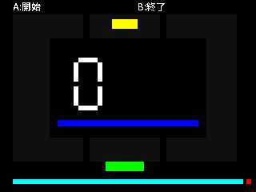

# Scratch Arcade OS

[English](README.md) | 日本語

[](https://github.com/ayutaz/scratch-arcade-os/actions/workflows/host-tests.yml)

**Macでゲームやツールを作り、ESP32-S3の携帯ゲーム機で動かすためのOSです。**

日本語のホーム画面から、自作アプリを選んで起動・終了できます。アプリの追加や更新のたびに、OSをビルドし直す必要はありません。



*画像はMac上のシミュレーターです。Scratch Arcadeの公式ファームウェアとは別の個人開発プロジェクトです。*

## できること

- ボタンやジョイスティックでゲームを操作
- 最高得点やタイマー設定を保存し、通常再起動後も保持
- 音の再生と、RAMを使った最大2秒の録音・再生
- Wi-Fi経由でMacからタイマーを操作

アプリはC99で書き、WebAssemblyに変換して実行します。OSはESP-IDF・FreeRTOS・WAMRを使っています。内部の仕組みは[アーキテクチャ](docs/architecture.md)にまとめています。

## Macでゲームを試す

必要なのは**Apple SiliconのMac、Git、[uv](https://docs.astral.sh/uv/getting-started/installation/)**です。Pythonはuvで管理し、3.12.13を使用します。この手順では実機は不要です。

```sh
git clone https://github.com/ayutaz/scratch-arcade-os.git
cd scratch-arcade-os
uv sync --locked
uv run --locked python tools/bootstrap.py --font
PYTHONPATH=prototypes/lab-os uv run --locked python -m labos.project run apps/lane-catcher
```

初回は指定バージョンのコンパイラー・実行環境・フォントを取得します。最後のコマンドでランチャーが開きます。**Z（A）**でLane Catcherを開き、もう一度押すとゲームが始まります。

移動は矢印キーです。**Z＝A、R＝X、X＝B、F＋X＝FN＋B**に対応します。

Macではゲームの動きと描画を確認できます。標準ウィンドウでは実機の音声・通信・保存機能には接続せず、対応アプリは未接続時の画面を表示します。処理速度・液晶の見え方・音質は実機で確認します。

## 付属アプリ

| アプリ | 内容 |
|---|---|
| [Lane Catcher](apps/lane-catcher/README.md) | 3レーンで目標を集め、最高得点を保存するゲーム |
| [Maze Runner](apps/maze-runner/README.md) | 壁を避けて目標を集める迷路ゲーム |
| [Focus Timer](apps/focus-timer/README.md) | 10〜300秒のタイマーと設定保存 |
| [Voice Recorder](apps/voice-recorder/README.md) | 2秒の録音と再生 |
| [Audio Desk](apps/audio-desk/README.md) | テスト音・短い録音・再生音量の確認 |
| [Remote Timer](apps/remote-timer/README.md) | Macからタイマーの開始・停止・状態確認 |

SDKには、さらに小さなサンプルを5本収録しています。ファームウェアの新規ビルドに入るのはgameとcounterで、ほかのアプリは個別に追加します。

## 実機向けのビルド

現在の対象は、**調査した1台のScratch Arcade系ESP32-S3基板**です。導入を検討する際は、先に[基板情報](boards/scratch-arcade/README.md)を確認してください。

```sh
uv run --locked python tools/bootstrap.py --idf
uv sync --project firmware/esp-idf/host-tools --locked
PYTHONPATH=prototypes/lab-os uv run --locked python -m labos.target build-candidate
```

この手順はビルドだけを行います。`scripts/flash.sh`は実機への書き込みを拒否します。

1台では順位診断を含む個別レビュー済みのv3音声版が動いています。最新の実声試験は6/15語が正解で、認識品質は目標未達です。[音声サービスの記録](docs/voice-service.md)・[検証記録](docs/validation.md)・[開発手順](docs/development.md)を参照してください。

別途検証したモデルのexportを使う[261特徴の音声ランタイム](docs/voice-context-runtime.md)も、ホスト実験向けに明示選択できます。実機の受入は未完了です。

## 自作アプリの開発

[SDKとアプリ制作手順](docs/development.md)から始められます。ホストテストは次のコマンドで実行します。

```sh
uv run --locked python tools/test.py
```

TDDとPRの流れは[貢献手順（英語）](CONTRIBUTING.md)を参照してください。CIはリポジトリ検査・ホスト試験・ESP32-S3ビルド・Python依存監査の4項目で、すべての成功をmainへのマージ条件にしています。バージョンタグからのソース配布は[CI/CD](docs/ci-cd.md)にまとめています。

詳細な開発ドキュメントは現在、日本語で記載しています。

## ライセンス

自作コードは[Apache-2.0](LICENSE)です。第三者コードやフォントには、それぞれのライセンスが適用されます。[NOTICE](NOTICE)と[第三者の権利表示](THIRD_PARTY_NOTICES.md)を参照してください。
