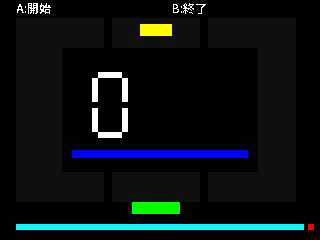

# Scratch Arcade OS

English | [日本語](README.ja.md)

[](https://github.com/ayutaz/scratch-arcade-os/actions/workflows/host-tests.yml)

A small ESP32-S3 OS with a Japanese home screen and installable games and tools. Built on ESP-IDF/FreeRTOS and WAMR, it runs C99 applications compiled to WebAssembly.

**Add and update individual apps without rebuilding the OS.** Test the same WASM on a Mac and use shared APIs for buttons, graphics, audio, persistent settings, and UDP on the device.



This is a host-rendered image, not a device photograph. This independent experimental project is not official Scratch Arcade firmware.

## Features

| Area | Implementation |
|---|---|
| Home | Fixed Japanese labels; select, launch, and close one foreground app |
| Runtime | WAMR fast interpreter; instruction, bounds, capability, and API-call limits |
| App management | USB transfer, SHA-256/ABI checks, individual updates, rollback versions, deletion, and GC |
| Graphics and input | 320 x 240 RGB565 scanlines, rectangles, pressed/held/released events, and elapsed time |
| Audio | Diagnostic tones, up to 2 seconds of RAM recording/playback, progress, and playback gain |
| Storage | Eight int32 slots per app, alternating CRC records, persistence across normal restarts |
| Network | OS-managed Wi-Fi STA and a fixed UDP peer; a Mac-controlled timer |
| Development | Wasmtime/WAMR comparison, host fixtures, a Mac window, and TDD |

Earlier device development verified launch/close for 11 apps, score/settings persistence after restart, and 2-second recording/playback after Wi-Fi shutdown. The firmware rebuilt from this extracted public repository has not been flashed again. See [validation scope](docs/validation.md).

## Try it on a Mac

Host tools currently target **macOS arm64, Python 3.12.13, and uv**.

```sh
git clone https://github.com/ayutaz/scratch-arcade-os.git
cd scratch-arcade-os
uv sync --locked
uv run --locked python tools/bootstrap.py --font
uv run --locked python tools/test.py
PYTHONPATH=prototypes/lab-os uv run --locked python -m labos.project check apps/lane-catcher
PYTHONPATH=prototypes/lab-os uv run --locked python -m labos.project run apps/lane-catcher
```

Bootstrap fetches pinned WAMR/littlefs commits, a checksum-verified Zig compiler, and the font when requested. It stops rather than overwriting mismatched dependencies. It does not access a device.

Controls: arrow keys; Z = A; R = X; X = B; F + X = FN + B. The default Mac window has no physical audio, network, or storage backend; related apps show their fallback state. It does not emulate ESP32 timing, the physical LCD, or audio quality.

## Included apps

| App | Purpose |
|---|---|
| [Maze Runner](apps/maze-runner/README.md) | Navigate around walls and collect targets |
| [Audio Desk](apps/audio-desk/README.md) | Diagnostic tone, 500 ms recording/playback, and gain |
| [Lane Catcher](apps/lane-catcher/README.md) | Three-lane game with a persistent high score |
| [Focus Timer](apps/focus-timer/README.md) | 10-300 second timer with persistent settings |
| [Voice Recorder](apps/voice-recorder/README.md) | 2-second RAM recording/playback |
| [Remote Timer](apps/remote-timer/README.md) | Start, stop, and query from a Mac |

The SDK also includes counter, game, microphone, network, and speaker examples. A new firmware build seeds only game and counter, not all 11 apps.

## Build for ESP32-S3

```sh
uv run --locked python tools/bootstrap.py --idf
uv sync --project firmware/esp-idf/host-tools --locked
PYTHONPATH=prototypes/lab-os uv run --locked python -m labos.target build-candidate
PYTHONPATH=prototypes/lab-os uv run --locked python -m labos.target size-candidate
```

These are build-only commands. The board configuration covers one observed Scratch Arcade S3 device; compatibility with other Maker/LITE boards or PCB revisions and preservation of existing device data are not guaranteed. See [board scope](boards/scratch-arcade/README.md) and [development boundaries](docs/development.md). `scripts/flash.sh` always refuses. Stock restoration images and device-specific deployment tools are not included.

## CI/CD and contributions

Every PR and main update runs repository checks, host tests, an ESP32-S3 build, and Python dependency audits. Weekly runs catch upstream changes. Main requires a PR and all four checks, including for administrators; a second reviewer is not required for solo development.

A `vMAJOR.MINOR.PATCH` tag matching the project version re-runs CI before publishing a source archive and SHA-256 checksum. Firmware binaries are not published. See [CI/CD and branch protection](docs/ci-cd.md) and [contribution workflow](CONTRIBUTING.md).

## Layout

| Path | Contents |
|---|---|
| `prototypes/lab-os/native/` | Shared C services, VM, home, filesystem, and USB protocol |
| `prototypes/lab-os/sdk/` | C99 SDK and five basic apps |
| `prototypes/lab-os/labos/` | Mac tools, builders, both VMs, and transfer client |
| `firmware/esp-idf/` | Target candidate, finite core, shared BSP, and separate uv environment |
| `boards/scratch-arcade/` | Limited board profile and remaining unknowns |
| `apps/` / `tests/` | Six additional apps and host contract/fault tests |
| `tools/` | Pinned dependency setup, strict test runner, repository checks, and source packaging |

[SDK and development](docs/development.md) · [Architecture](docs/architecture.md) · [Validation](docs/validation.md) · [Dependencies](docs/dependencies.md). Detailed engineering documents are currently in Japanese.

## License and scope

Original code is licensed under [Apache-2.0](LICENSE). Third-party code, the MicroPython-derived ASCII font, and Noto-derived glyphs retain their respective licenses. See [NOTICE](NOTICE) and [third-party notices](THIRD_PARTY_NOTICES.md).

Stock firmware, extracted code, raw Flash backups, recordings, Wi-Fi credentials, and personal device identifiers are not distributed. OS OTA, complete native-app isolation, arbitrary Japanese text input, BLE, and ASR/TTS remain unimplemented or unverified.
