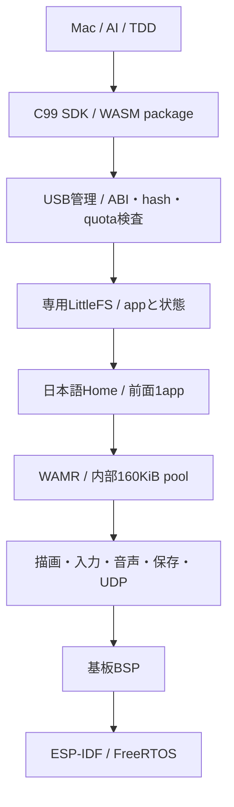

# アーキテクチャ

ESP-IDF/FreeRTOSをカーネルとし、その上のHome・app管理・SDK・サービスを独立実装する。通常のOS taskとnative bindingは信頼領域で、任意native faultを隔離するMMUプロセスではない。

| 境界 | 契約 |
|---|---|
| VM | software bounds、命令数上限、未公開import/constructor拒否。native callbackの暴走は保証外 |
| 描画 | 320×240、正の矩形、128命令/呼出し。実機は640B行buffer |
| app | 登録16本、転送16KiB、前面1本。署名/OS OTAは未実装 |
| 入力 | held/pressed/released/実時間。FN+BをOSが先に処理し、全キー解放後Homeへ |
| 状態 | storage権限、app IDに紐付く8×int32。交互52B CRC記録、最大32 ID |
| 保存負荷 | 同値はI/Oなし。変更commitは同lease内1秒制限。実電断/摩耗は未保証 |
| 音声 | OS lease、PDM/I2S、最大2秒/32,000frames。本体RAMだけに保持し終了解放 |
| 通信 | OSがWi-Fi/固定UDP peerを管理。guestには資格情報/socketを渡さず、最大64B |

source SDKは[lab_os.h](../prototypes/lab-os/sdk/lab_os.h)。ABI2のままoptional importを追加しているので、ABI番号だけで旧FWとの互換性を判断しない。

NVSへのWi-Fi/PHY保存とPSRAMは無効。OS slot1MiB＋専用LittleFS1MiB、OS OTAなし。これは純正パーティション配置ではなく、自動で安全に移行できるレイアウトでもない。

[検証範囲](validation.md)を参照。CPU上限/リンク時空き/実heap、hostのVM pool実容量とS3値を混同しない。

## 日本語音声の候補実装

[voice service](voice-service.md)は完了録音の分類と固定返答を既存音声leaseへ接続する。
ホスト/S3 buildまでで、実機への適用は別の固定imageレビューと個別許可を要する。
